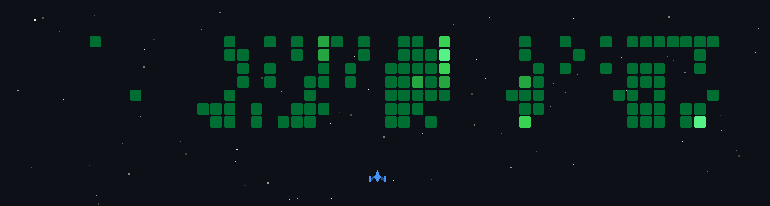

## Contribution Space Shooter

  

  

  

### 👋 Hey, I'm Maksim Fursov!

I'm a full-stack builder and founder from San Francisco with a passion for architecting the future on the decentralized web and SaaS startups. I thrive on turning ambitious ideas into tangible, user-centric products from concept to deployment. My happy place is at the intersection of clean code, scalable infrastructure, and innovative web3 concepts.

---

### 🚀 Founder & Builder

As a hands-on founder, I lead product development from architecture to launch. Here are the ventures I'm currently building:

*   **[VettaX](https://vetta-x.com)**: A platform designed to simplify your posting activities while you are shipping new startups. I'm architecting and building the full-stack application, using Python, PostgreSQL, Redis and many more. 
*   **RookieAI**: An AI-powered tool that helps students to apply to UK universities specifically, it takes 10 minutes to get a taste of where you will most likely to get into with your input information. I will open it once again during fall so you can use it to apply. 

---

### 🎯 What I'm Focused On

*   💡 **Building Ventures:** Leading the full product lifecycle for my startups, from initial architecture and smart contract design to frontend development and deployment.
*   🌐 **Full-Stack dApp Development:** Building and deploying decentralized applications from scratch using Next.js, Solidity, Ethers.js, and deploying via Lovable.
*   🛠️ **Scalable Architectures:** Designing resilient backend systems with Python and PostgreSQL, and containerizing services with Docker for consistent, scalable deployments.

---

### 🌱 Currently Exploring

*   Diving into **Go** for building high-performance, concurrent backend services.
*   hardware development environments 

---

### 💻 My Tech Stack

| Frontend                               | Backend                            | Blockchain                      | Databases & DevOps                                |
| -------------------------------------- | ---------------------------------- | ------------------------------- | ------------------------------------------------- |
| TypeScript                             | Node.js                            | Solidity                        | PostgreSQL                                        |
| React / Next.js                        | Python                             | Ethers.js / viem                | Supabase                                          |
| Tailwind CSS                           | GraphQL                            | Hardhat / Foundry               | Docker                                            |
| Zustand / Redux                        | REST APIs                          | Chainlink                       | Lovable / AWS                                      |

---

### 📊 My GitHub Journey

  

  

---

### 🤝 Let's Connect!

I'm always open to connecting with fellow developers, entrepreneurs, and innovators. Let's build something cool together!

  
  
  
  

